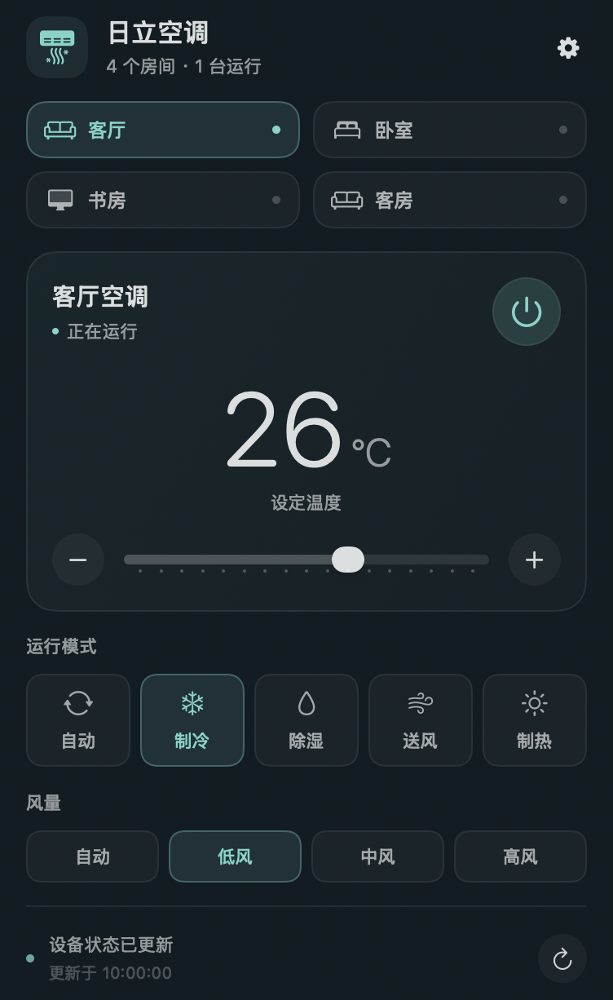

# 日立空调 · HitachiMenuBar

在 macOS 菜单栏控制通过「日立智家」关联到米家的日立中央空调。每台 Mac 独立扫码登录，可以跨网络使用，无需 Home Assistant、Tailscale 或家中 Mac 常开。



截图为 v0.3.3 的功能示意，使用演示数据。v0.3.4 在 macOS 26+ 使用系统 Liquid Glass 背景，较旧系统使用菜单毛玻璃；底色随桌面变化。

## 下载与安装

要求 **macOS 13 或更新版本**。

| Mac 类型 | 下载 |
| --- | --- |
| Apple Silicon（M 系列） | [arm64.zip](https://github.com/VUVUDOG/HitachiMenuBar/releases/download/v0.3.4/HitachiMenuBar-0.3.4-arm64.zip) |
| Intel 处理器 | [intel.zip](https://github.com/VUVUDOG/HitachiMenuBar/releases/download/v0.3.4/HitachiMenuBar-0.3.4-intel.zip) |

[全部版本与图文指南](https://github.com/VUVUDOG/HitachiMenuBar/releases) · [安装使用说明](docs/usage.md)

1. 手机米家 → 连接三方平台 → 日立中央空调，输入日立智家账号密码完成关联，确认米家能控制设备。
2. 下载匹配芯片的 ZIP，解压后将 `HitachiMenuBar.app` 放入「应用程序」并打开。
3. 点击菜单栏「空调」，选择「扫码登录米家」，用已关联设备的米家账号扫码并在手机确认。
4. 等待房间和状态载入，选择房间进行控制。

安装包包含运行环境，无需安装 Python、uv 或开发工具。每台 Mac 各自登录。

## 功能

- 系统玻璃背景、圆角与窗口阴影；macOS 26+ 使用原生 Liquid Glass，macOS 13–15 自动回退到菜单毛玻璃。
- 多房间切换、开关、设定温度、运行模式和风量。
- 控制选项按设备功能定义生成，读取不到或不可写的功能不开放操作。
- 展开面板立即发起刷新，随后每 30 秒刷新；收起后暂停。
- 控制后回读确认，底部显示更新时间与连接提示。
- 齿轮菜单提供同步房间、重新登录、退出登录、复制诊断和退出应用。
- 登录会话保存于本机系统钥匙串；成功读取后，本次运行的后续请求复用内存会话。

已验证设备支持 16–32°C、自动 / 制冷 / 除湿 / 送风 / 制热，以及自动 / 低 / 中 / 高风。具体选项以设备能力为准。已验证设备不提供实测室温，大数字为**设定温度**。

## 当前说明

第三方工具，非日立或小米官方产品，尚未验证全部日立型号；连接依赖米家与日立云端服务。

当前使用 ad-hoc 开发签名，未取得 Developer ID 签名或 Apple 公证。首次启动如提示无法验证开发者，确认下载来源后可在「系统设置 → 隐私与安全性」允许打开。

钥匙串弹窗需要当前 Mac 的「登录」钥匙串密码。选择「始终允许」可记住对当前程序的授权；更新版本可能触发重新授权。重复弹窗仍是已知问题，不能保证所有 Mac 已消除。账号登录态与系统授权是独立状态。

Intel 版已通过 Apple Silicon 主机上的 Rosetta 验证，尚未在实体 Intel Mac 上实测。

## 源码构建

开发需要 macOS、Xcode 26 或更新版本（包含 macOS 26+ SDK） 和 [uv](https://docs.astral.sh/uv/)。

Apple Silicon：

```sh
uv sync --frozen --python 3.12
uv run python build.py --worker
```

输出 `dist/HitachiMenuBar.app`。仅修改 Swift 界面后可运行 `uv run python build.py`；云端代码变更后需要 `--worker`。

在 Apple Silicon 主机上构建 Intel 版，需要 Rosetta 和独立的 x86_64 Python：

```sh
uv python install cpython-3.12.13-macos-x86_64-none
UV_PROJECT_ENVIRONMENT=.venv-intel uv sync --frozen --python cpython-3.12.13-macos-x86_64-none
.venv-intel/bin/python build.py --arch x86_64 --worker
```

输出 `dist/intel/HitachiMenuBar.app`。必须使用与目标架构对应的 Python 构建。

## 验证与反馈

```sh
uv run python -m unittest -v
uv run python verify_app.py
.venv-intel/bin/python verify_app.py --arch x86_64
uv run python verify_packages.py
```

单元测试与原生回归使用临时目录、模拟钥匙串和模拟会话，不控制真实空调。打包检查要求两种架构已构建。

`verify_previews.py` 读取本机设备缓存生成预览；`verify_control.py` 是真实设备集成检查，会调节指定关机房间设定温度并恢复，仅在需要真实设备验证时手动运行。

运行数据位于 `~/Library/Application Support/HitachiMenuBar`；开发脚本默认使用 `.runtime/`。这些文件及凭证不属于源码或发行包。

请在 [Issues](https://github.com/VUVUDOG/HitachiMenuBar/issues) 提供版本、Mac 芯片、macOS 版本、复现步骤及「齿轮 → 复制诊断信息」。诊断不含账号、密码、设备标识或登录会话；不要提交实时二维码或设备报告。

## 实现参考

- [hass-xiaomi-miot](https://github.com/al-one/hass-xiaomi-miot)：第三方设备列表和 MIoT 云端请求。
- [Xiaomi-cloud-tokens-extractor](https://github.com/PiotrMachowski/Xiaomi-cloud-tokens-extractor)：米家扫码协议。
- [日立智家关联米家社区讨论](https://bbs.hassbian.com/archiver/?tid-28735.html)。
