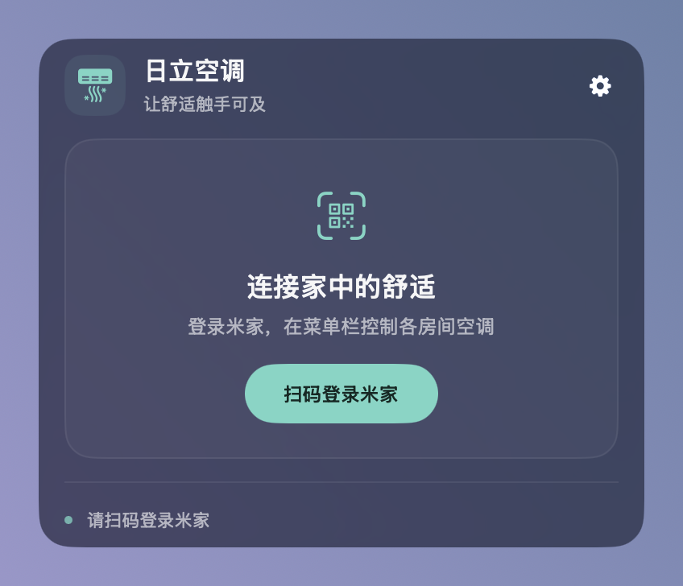
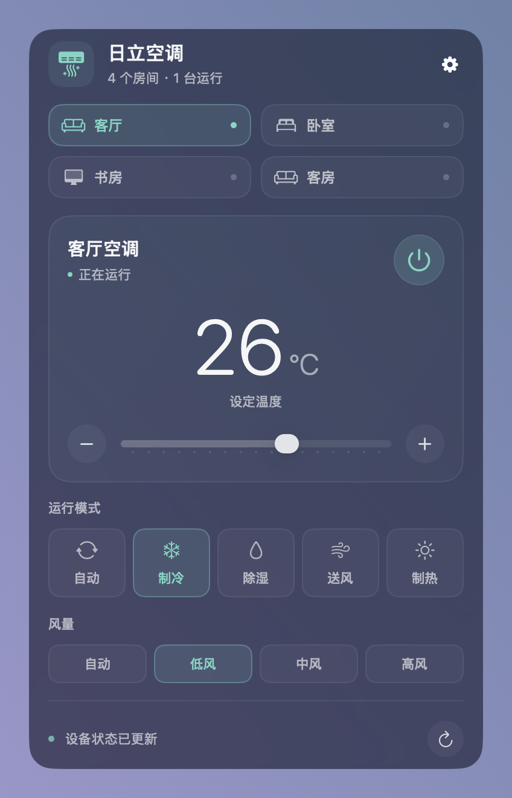

# 米家菜单栏 · 安装与使用

> **第三方工具，非小米官方。**

[下载最新版](https://github.com/VUVUDOG/MijiaMenuBar/releases/latest)。本说明对应 **v0.5.1**；截图沿用 v0.3.4 界面（演示数据），不含新增的房间行和设备列表。

## 1. 准备

确认手机米家 App 能控制要使用的设备。日立中央空调需先在米家 → 连接三方平台 → 日立中央空调中输入日立智家账号完成关联。

## 2. 安装

 → 关于本机：M 系列选择 `arm64.zip`，Intel 选择 `intel.zip`。要求 macOS 13+。

解压，将 `MijiaMenuBar.app` 放入应用程序并打开。当前未公证，若系统提示无法验证开发者，确认来源后在「系统设置 → 隐私与安全性」选择「仍要打开」。

从旧版「日立空调」（`HitachiMenuBar.app`）升级：在旧版齿轮菜单选择「退出应用」，删除 `HitachiMenuBar.app`，再打开新版。登录状态会保留；如之前开启了「开机自动启动」，请在新版齿轮菜单重新打开一次。

## 3. 扫码登录

点击菜单栏「米家」→「扫码登录米家」，用米家 App 扫描软件中的实时二维码并在手机确认。过期时重新发起扫码。每台 Mac 独立登录。

## 4. 控制面板

| 位置 | 用法 |
| --- | --- |
| 房间 | 按米家房间切换，显示房间温度；绿点表示房间内有设备开着。切换本身不会控制设备。 |
| 空调卡片 | 所选房间有空调时显示：开关、设定温度（整数度，连按累加后只发送最终值）、模式、风量，以及同房间温湿度计的室温和湿度。 |
| 设备列表 | 显示房间内的灯、灯组、窗帘、插座、循环扇、空气净化器和浴霸。右侧开关直接开关设备；点击一行展开亮度、色温、窗帘开合、模式、风速等控制。离线设备显示为灰色。 |
| 右下角刷新 | 手动获取最新状态。 |
| 齿轮 | 同步房间、重新登录、退出登录、开机自动启动、检查更新、版本、复制诊断、退出应用。 |

所有操作点击后立即显示，后台依次同步；发送中仍可继续操作，新操作会排队合并。云端未确认时恢复原状态，底部提示原因。

展开立即刷新，随后每 30 秒自动刷新；设备列表只读取当前房间，切换房间时刷新；收起暂停。点击面板外或按 Esc 收起。

只显示空调所在米家家庭的设备。墙壁开关暂不接入，以免给智能灯断电；门锁、摄像机等安全类设备不接入。新增设备或调整米家房间后，点击齿轮菜单「同步房间」。

## 5. 钥匙串与账号

- 输入当前 Mac 的「登录」钥匙串密码，通常与本机登录密码相同。
- 确认为本软件请求后，「始终允许」记住授权；「允许」仅限本次。
- 退出应用保留凭证；退出登录清除凭证和设备缓存。
- 重新登录立即作废旧会话，取消扫码不会恢复旧账号。
- 开发签名更新可能重新申请授权。

## 6. 排查与更新

没有房间或设备时检查米家账号和手机设备列表，再「同步房间」。状态异常时看底部提示，检查设备在线并手动刷新。提示登录失效后重新扫码。

发现新版本时面板会出现「发现新版本」，点击「更新」自动下载、校验并重新打开；也可在齿轮菜单「检查更新」。校验不通过会取消安装，当前版本不受影响。

需要开机自动运行时，在齿轮菜单打开「开机自动启动」；首次开启如系统要求，在「系统设置 → 通用 → 登录项」中允许。

反馈时提供版本、Mac 芯片、macOS 版本、步骤和诊断信息。
